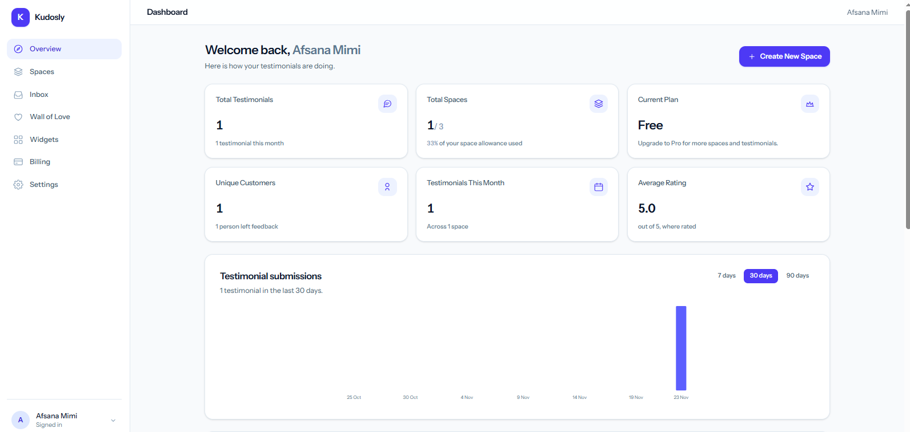
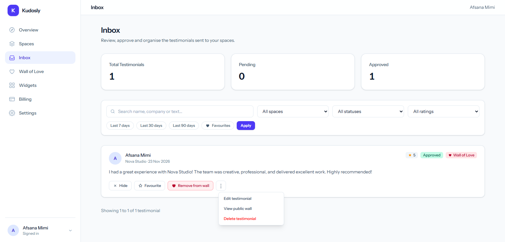
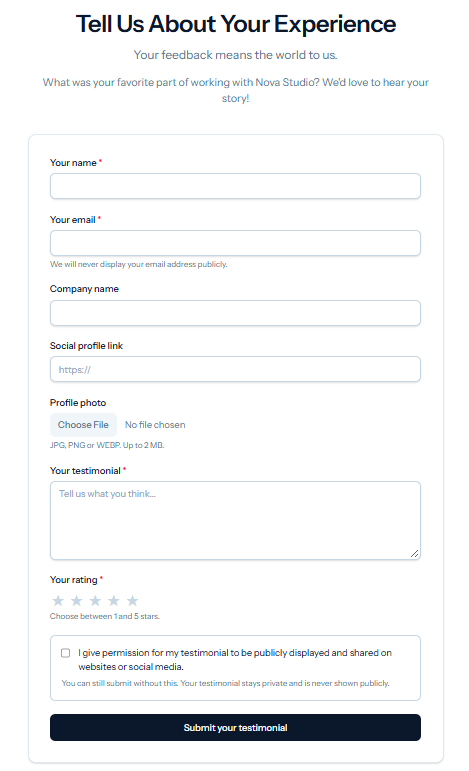
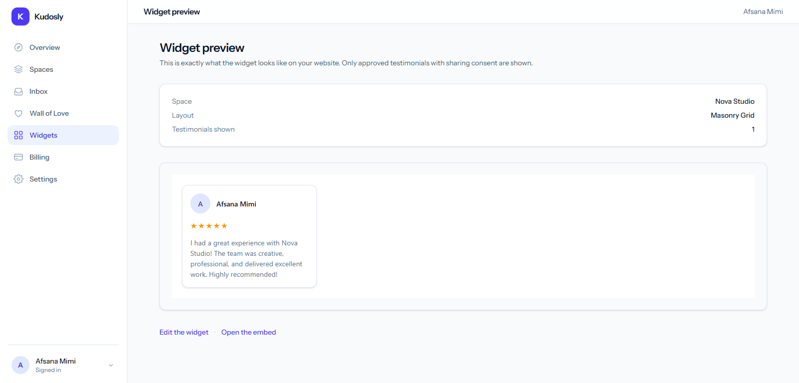
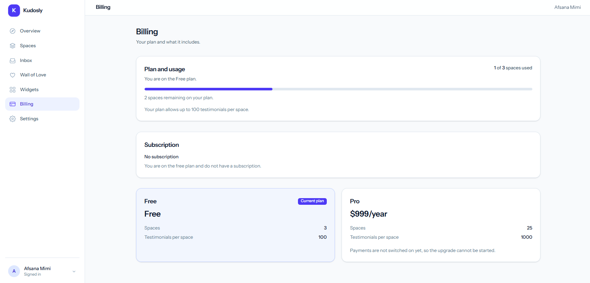

# Kudosly

Kudosly is a self-hosted testimonial collection SaaS. Owners create branded **Spaces**,
share a public collection link, collect written testimonials from customers without
requiring them to register, moderate them in a shared inbox, and publish the approved
ones on a public wall of love or inside embeddable widgets on their own website.

The application is a Laravel 13 monolith with server-rendered Blade views, a Tailwind
CSS 4 front end, Laravel Cashier for Stripe billing, and a Pest feature-test suite.

---

## Table of contents

- [Screenshots](#screenshots)
- [Technology stack](#technology-stack)
- [Installation](#installation)
- [Running the application locally](#running-the-application-locally)
- [Demo data](#demo-data)
- [Completed features](#completed-features)
- [Features that are not configured yet](#features-that-are-not-configured-yet)
- [Database overview](#database-overview)
- [Testing](#testing)
- [Project structure](#project-structure)
- [AI tooling disclosure](#ai-tooling-disclosure)
- [Documentation](#documentation)

---

## Screenshots

Every image below is a genuine browser capture of this code base, taken by hand
against the running application. The full set, with a description of each file, is
listed in [`docs/screenshots/README.md`](docs/screenshots/README.md).

| Dashboard | Inbox |
| --- | --- |
|  |  |

| Public collection form | Wall of love |
| --- | --- |
|  |  |

| Widget preview | Billing |
| --- | --- |
|  |  |

The Spaces list, the space and widget builders, the profile page and a standalone
testimonial card are also captured.

**A note on the data.** These captures were taken from a working account, so the
account holder's display name appears in the header and the sidebar, and one
testimonial is shown with its author's name, company and rating. No e-mail address,
password, payment detail or API key is visible in any of them — the profile form
is shown empty, and the public pages show no e-mail address at all, which is the
application's own privacy behaviour.

---

## Technology stack

| Layer | Choice | Version |
| --- | --- | --- |
| Language | PHP | 8.3+ (developed on 8.5) |
| Framework | Laravel | 13.17 |
| Billing | Laravel Cashier | 16.11 |
| Payment SDK | `stripe/stripe-php` | 21.3 |
| Front end | Blade + Tailwind CSS | Tailwind 4 (CSS-first config) |
| Build tool | Vite | 8.x |
| JS runtime | Node | 26.x |
| Tests | Pest (PHPUnit wrapper) | 5.3 |
| Code style | Laravel Pint | 1.27 |
| Local server | Laravel Herd | — |

Livewire is installed as a dependency but is **not currently used**; the interface is
Blade with small inline vanilla-JS blocks. See `CLAUDE.md` for the conventions this
project follows.

---

## Installation

### Requirements

- PHP 8.3 or newer, with the `pdo_mysql`, `mbstring`, `openssl`, `tokenizer`, `xml`, `curl` and `fileinfo` extensions
- Composer 2
- Node.js 20 or newer and npm
- MySQL 8 / MariaDB 10.6 or newer — **or** SQLite for a throwaway local preview
- [Laravel Herd](https://herd.laravel.com) is the easiest way to get PHP and a site on Windows or macOS

### Steps

The repository ships three Composer scripts that cover the whole setup.

```bash
# 1. Install PHP and JavaScript dependencies, create .env, generate the app key,
#    run the migrations and build the front end.
composer setup
```

`composer setup` runs, in order:

1. `composer install`
2. copies `.env.example` to `.env` if `.env` does not exist yet
3. `php artisan key:generate`
4. `php artisan migrate --force`
5. `npm install --ignore-scripts`
6. `npm run build`

### Configure the environment

After `composer setup`, open `.env` and set at least:

```dotenv
APP_NAME=Kudosly
APP_URL=http://kudosly.test

DB_CONNECTION=mysql
DB_HOST=127.0.0.1
DB_PORT=3306
DB_DATABASE=kudosly
DB_USERNAME=root
DB_PASSWORD=
```

The `.env` file is **gitignored**. Only `.env.example` is tracked, and it contains no
real credentials.

### Optional but recommended

| Variable | Purpose |
| --- | --- |
| `STRIPE_KEY`, `STRIPE_SECRET`, `STRIPE_WEBHOOK_SECRET` | Required to exercise the real Stripe checkout and webhooks. See [Features that are not configured yet](#features-that-are-not-configured-yet). |
| `MAIL_MAILER`, `MAIL_HOST`, `MAIL_PORT`, `MAIL_USERNAME`, `MAIL_PASSWORD`, `MAIL_ENCRYPTION` | Required to deliver password-reset and notification emails. The default `log` mailer writes messages to `storage/logs/laravel.log` instead. |

---

## Running the application locally

```bash
# Starts the PHP server, the queue worker and the Vite dev server together.
composer dev
```

`composer dev` runs `php artisan dev`, which starts:

- the Laravel application server
- a queue worker
- the Vite development server with hot module replacement

Then open the URL printed by the command (by default <http://127.0.0.1:8000>).

If you prefer to run the pieces separately:

```bash
php artisan serve     # application
npm run dev           # front-end assets with hot reload
php artisan queue:work  # background jobs, only needed for e-mail delivery
```

### Verifying the front end

If the styles look unstyled, the assets were not built. Run:

```bash
npm run build
```

### Handy commands

| Command | What it does |
| --- | --- |
| `php artisan migrate` | Apply pending migrations |
| `php artisan migrate:rollback` | Roll the last migration batch back |
| `php artisan db:seed --class=PlanSeeder` | Insert the Free and Pro plan rows |
| `php artisan db:seed --class=DemoSeeder` | Insert the demo account and its content (local preview only) |
| `php artisan route:list` | List all 67 routes |
| `php artisan storage:link` | Serve uploaded profile pictures from `/storage` |
| `vendor/bin/pint` | Format the code |
| `vendor/bin/pest` | Run the test suite |

---

## Demo data

A dedicated seeder builds a realistic preview account with several spaces and
testimonials spread across every moderation state, so that the inbox, the wall of
love and the dashboard chart all have something to show.

```bash
# Local preview only. This writes rows — never run it against a shared database.
php artisan db:seed --class=DemoSeeder
```

| | |
| --- | --- |
| Email | `demo@kudosly.test` |
| Password | `password` |

`DemoSeeder` is separate from `DatabaseSeeder` on purpose, so it can never run by
accident. It is the quickest way to get a usable local preview.

The screenshots in this README were **not** taken from this seeder. They were
captured by hand from a working account, so they show a real space, a real widget
and a real testimonial rather than the seeded placeholders. Seeding this account
is still the recommended way to try the application locally without touching any
real records — every customer e-mail address it writes uses the reserved
`example.test` domain.

---

## Completed features

All items below are implemented, wired up and covered by automated tests.

### Authentication and accounts

- Registration, sign in, sign out, and account switching between several accounts
- Password reset by e-mail, including token expiry, single use and no account enumeration
- Passwords stored with `hashed` casting; e-mail addresses normalised to lower case on write
- E-mail lookup that is case-insensitive on every database engine, not only on MySQL
- Profile page with name, e-mail and profile photo upload
- Three policies (`SpacePolicy`, `TestimonialPolicy`, `WidgetPolicy`) enforced in the controllers

### Spaces

- Create, edit and delete spaces, each with its own public collection URL
- Customisable collection form: which fields are shown, which are required, and the order
- Per-space themes and an optional star rating
- Live preview of the public collection page
- Space quota shown in the UI, with an upgrade prompt when the plan limit is reached

### Public testimonial collection

- Public form at `/s/{space:slug}` that requires **no** account
- Rate limiting by IP address, enforced by Laravel's throttle middleware, returning HTTP 429
- A honeypot field plus a silent rejection path, so a bot cannot tell that it was filtered
- Plan limits enforced server side: a space that has reached its testimonial quota stops accepting new ones
- Sharing consent captured at submission time; testimonials without consent never appear publicly

### Inbox and moderation

- Central inbox with search and filters for space, status and rating
- Approve, hide, favourite, pin to the wall of love, edit and delete
- An ellipsis menu per testimonial with the secondary actions
- Pagination and a dedicated ordering scope for the inbox

### Wall of love and widgets

- Public wall page per space at `/wall/{space:slug}`
- Widget builder with masonry and carousel layouts, theme mode, background colour, animation toggle and a display limit
- Three embed types: JavaScript snippet, iframe and a plain data URL
- Embeds are cacheable, work cross-origin, resize automatically and do not leak styles into the host page
- Widgets expose only testimonials that are approved, consented and publicly visible

### Dashboard

- Statistics computed from real database records: totals, unique customers, monthly submissions, average rating
- A submissions chart with 7, 30 and 90 day ranges
- Space list with a working search box and per-space counters

### Billing

- Free and Pro plans stored in the `plans` table, with a `PlanCatalog` that resolves entitlements
- Stripe Checkout for the Pro plan through Laravel Cashier
- Webhook handling with signature verification and idempotent event processing
- Subscription management through the Stripe customer portal
- Usage counters and an upgrade prompt on the billing page

### Security and reliability

- CSRF protection on every form, server-side validation through Form Requests
- Output escaping via Blade's `{{ }}` syntax
- Rate limiting and a honeypot on the public submission route
- Soft deletes on spaces, testimonials and widgets
- Stripe webhook signatures verified; the plan is never activated from a Checkout redirect alone
- E-mail addresses and private testimonials are never exposed by a public endpoint

---

## Features that are not configured yet

These parts of the application are **written and tested, but cannot be demonstrated
end to end in this environment** because no third-party credentials are configured.
They are listed here so the state of the project is not overstated.

| Area | State | What is needed |
| --- | --- | --- |
| **Live Stripe payments** | Code complete, exercised only against a fake gateway in tests | `STRIPE_KEY`, `STRIPE_SECRET` and `STRIPE_WEBHOOK_SECRET` from a Stripe account, plus a product priced at $999/year |
| **Stripe customer portal** | Code complete, not exercised live | The same Stripe credentials, and the portal enabled in the Stripe dashboard |
| **Outbound e-mail (SMTP)** | The mail layer works and writes to `storage/logs/laravel.log` via the `log` mailer. Password-reset e-mails are generated, tokenised and tested, but **no real e-mail has been sent** | A mail provider: host, port, username, password, encryption and a verified sender address |
| **Production deployment** | A complete runbook exists at [`docs/deployment.md`](docs/deployment.md) | A real server. Nothing has been deployed |
| **Automated e-mail in the queue** | Queued jobs are configured and the worker command is documented | A running queue worker (`php artisan queue:work`) |

Two consequences worth stating plainly:

- The price of **$999 per year** is the approved figure from the PRD. It is stored in
  the `plans` table and enforced everywhere, but no live charge has been taken.
- The password-reset flow is verified end to end except for the final hop over SMTP:
  the token is created, hashed, delivered to the notification layer, expires correctly,
  is single use, and deletes itself after use. What has never happened is a message
  reaching a real inbox.

---

## Database overview

Seven application entities plus the standard Laravel and Cashier tables.

| Entity | Purpose | Key relationships |
| --- | --- | --- |
| `users` | Account owners | belongs to one `plans` row; has many `spaces` |
| `plans` | Free and Pro plan definitions | referenced by `users.plan_slug` |
| `spaces` | A branded collection page | belongs to a `user`; has many `space_fields`, `testimonials` and `widgets` |
| `space_fields` | Which form fields a space shows | belongs to a `space` |
| `testimonials` | A submitted testimonial | belongs to a `space` |
| `widgets` | An embeddable display of a space | belongs to a `space`; addressed publicly by `public_id` |
| `stripe_webhook_events` | Processed Stripe event ids, for idempotency | — |
| `subscriptions`, `subscription_items` | Laravel Cashier billing state | belong to a `user` |

All of `spaces`, `testimonials` and `widgets` use soft deletes, so a deleted record
stays recoverable and never leaks into a public page.

The full column-level description, with an entity-relationship diagram, is in
[`docs/data-model.md`](docs/data-model.md).

---

## Testing

The suite is written with Pest and runs against an in-memory SQLite database, so it
never touches a development or production database.

```bash
# The full suite
vendor/bin/pest

# A single file
vendor/bin/pest tests/Feature/Billing/WebhookTest.php

# With the in-memory database explicitly set (useful on Windows)
APP_ENV=testing DB_CONNECTION=sqlite DB_DATABASE=":memory:" vendor/bin/pest
```

**Current result: 690 tests, 1925 assertions, all passing.**

| Area | Files |
| --- | --- |
| Authentication and accounts | `tests/Feature/Auth/` (registration, login, password reset, profile, profile photo, account switching) |
| Authorization | `tests/Feature/Authorization/` (space, testimonial and widget policies) |
| Billing | `tests/Feature/Billing/` (page, checkout, entitlements, subscription management, webhooks) |
| Dashboard | `tests/Feature/Dashboard/` |
| Inbox and moderation | `tests/Feature/Inbox/` |
| Spaces and public collection | `tests/Feature/Spaces/` |
| Wall of love | `tests/Feature/WallOfLove/` |
| Widgets and embeds | `tests/Feature/Widgets/` |
| Navigation | `tests/Feature/Navigation/` |
| Models and units | `tests/Feature/Models/`, `tests/Unit/` |
| End-to-end | `tests/Feature/UserJourneyTest.php` |

`tests/Feature/UserJourneyTest.php` walks the whole product the way a person would:
register, create a space, share the collection link, submit a testimonial as a
visitor, approve it, put it on the wall of love and publish it in a widget.

---

## Project structure

```
app/
├── Billing/          Plan catalogue, checkout service, webhook handler, Stripe gateway
├── Enums/            PlanType, SpaceFieldKey, SpaceTheme, TestimonialStatus, WidgetLayout, WidgetThemeMode
├── Http/Controllers/ 19 controllers, grouped by area
├── Models/           User, Plan, Space, SpaceField, Testimonial, Widget, StripeWebhookEvent
├── Policies/         SpacePolicy, TestimonialPolicy, WidgetPolicy
├── Spaces/           Space field definitions and theme handling
└── Widgets/          Widget settings and layout handling

resources/
├── views/            58 Blade templates
├── css/app.css       Tailwind CSS 4 entry point (CSS-first configuration)
└── js/app.js         Front-end entry point

docs/
├── data-model.md     Entities, relationships, ER diagram
├── deployment.md     Production deployment and operations runbook
└── screenshots/      Screenshots tracked in git
```

---

## AI tooling disclosure

This project was built with the assistance of an AI coding agent. The disclosure below
describes what was actually used, and — just as importantly — what was **not**.

### Tool used: Puku CLI

All AI-assisted work in this repository was carried out through **Puku CLI**, a
command-line coding agent. It was used for:

- **Reading and understanding the existing code base** before every change.
- **Planning.** Work was planned against the PRD, phase by phase, and the plan was
  reviewed before implementation.
- **Implementation.** Controllers, models, migrations, policies, Form Requests, Blade
  views, tests and the front end were written with the agent's help.
- **Verification.** Every change was followed by the Pest suite, Laravel Pint, and —
  for interface work — automated browser checks with Playwright.
- **Diagnosis.** Several defects were found by measurement rather than guesswork, for
  example the inbox dropdown clipping bug, where the agent measured the rendered
  geometry in a real browser, identified the `overflow: hidden` ancestor as the cause,
  proved it by changing the value live, and only then wrote the fix.

### Subagents

Nine **Explore subagents** were dispatched to read parts of the code base in parallel
instead of serially, so that large areas could be surveyed at once:

| Area surveyed | Purpose |
| --- | --- |
| Phase 3 test coverage | Audit which behaviour was already covered by tests |
| Phase 3 Blade views | Audit the view layer for gaps |
| Public collection flow | Audit the public submission path |
| Moderation, wall and widgets | Audit three feature areas together |
| Laravel throttle patterns | Verify the framework's own rate-limiting behaviour in the installed source |
| Dashboard view structure | Map the dashboard templates |

### Parallel execution

The clearest example is the Phase 3 audit. Two subagents — *"Audit Phase 3 test
coverage"* and *"Audit Phase 3 Blade views"* — were dispatched with
`run_in_background: true` roughly two seconds apart, and both returned their results
in the same batch. They therefore ran **concurrently** rather than one after the
other. Across the whole project, fourteen long-running commands were also started in
the background (test suites, builds, local servers) while other work continued in the
foreground.

### The project skill

The second agentic tool used was a **Skill** — a packaged workflow that Puku CLI
loads and executes as a unit. One was written for this repository:
[`kudosly-doc-review`](.puku-cli/skills/kudosly-doc-review/SKILL.md). It reviews the
documentation and the screenshot assets for three classes of defect: broken
Markdown links, credential or secret exposure, and personal information that should
not be published. Findings are classified as `blocking`, `disclosure` or `info`.

It was genuinely invoked through the Puku CLI `Skill` tool against `README.md` and
`docs/`. The invocation is recorded in the session log as a tool-use block with
`"name":"Skill"` and `"input":{"skill":"kudosly-doc-review","args":"README.md
docs/"}`, and the loader's reply opens with `Base directory for this skill:`. The
review resolved every relative link target on disk, scanned the raw bytes of all
fifteen PNGs, and returned the verdict **`clean with disclosures`** — no broken
links, no secrets and no e-mail-address leaks, with the account holder's display
name and the space name correctly identified as disclosures rather than leaks.

### Branch-based work

The final documentation work was carried out on two feature branches in two
separate Git worktrees, located outside the repository so that nothing under
`.worktrees/` could ever be staged. Each branch owned exactly one document, so the
two could not conflict:

| Branch | Worktree | Document |
| --- | --- | --- |
| `feature/agentic-workflow-doc` | outside the repository | `docs/agentic-workflow.md` |
| `feature/reviewer-guide` | outside the repository | `docs/reviewer-guide.md` |

Two agents were dispatched in a single message with `run_in_background: true`, one
per branch, and they ran **concurrently** — the dispatch timestamps in the session
log show the first agent starting at `23:25:44.279Z` and the second at
`23:25:57.627Z`, while the first was still running. Both branches were merged into
`main` with `--no-ff`, so the history records two genuine merge commits with two
parents each rather than a linear run of commits.

`docs/agentic-workflow.md` documents this workflow in full, and
`docs/reviewer-guide.md` is a guide written for the course reviewer.

### What was **not** used

To keep this section accurate:

- **Claude Code was not used.** There is no Claude Code session history, no
  `~/.claude` directory and no `.claude/` configuration in this repository. The
  `CLAUDE.md` and `AGENTS.md` files in the root are project documentation for any
  coding agent, including Puku CLI.
- **No hooks and no MCP servers** were written or configured for this project.
  There is no `.mcp.json` in the repository, and the project entry in
  `~/.puku-cli/puku-cli.json` carries an empty `mcpServers` object. The browser
  checks described above were run as Node scripts through Playwright, not
  through an MCP server.
- **One custom skill** was written for this project, and it is the only one:
  [`kudosly-doc-review`](.puku-cli/skills/kudosly-doc-review/SKILL.md), a
  documentation and privacy review workflow. See
  [The project skill](#the-project-skill) below.
- **Laravel Boost is installed** as a development dependency (`laravel/boost`), but
  `php artisan boost:install` was deliberately **not** run, so `CLAUDE.md` and
  `AGENTS.md` contain hand-written project instructions rather than generated ones.

Every line of application code, test and documentation in this repository was written
or reviewed with agent assistance, and the full suite — 690 tests — passes against the
committed state.

---

## Remaining assignment requirements

One item still lacks real evidence. It is not a defect in the application.

1. **A demo recording.** The screenshots are done: the Dashboard, Spaces, the
   space and widget builders, the Inbox (including the three-dot actions menu
   open), the public collection form, the Wall of Love, the Widgets page, the
   rendered widget preview and Billing are all captured. See
   [`docs/screenshots/README.md`](docs/screenshots/README.md).

   What is still missing is a **short screen recording** of the public submission
   journey — open the collection link, fill in the form, submit, then approve the
   testimonial in the inbox and watch it appear on the wall. That would be the
   clearest single demonstration of the product. It has not been recorded.

   Two smaller gaps in the same area: the **widget embed is shown in the built-in
   preview** rather than embedded on a mock host page, and the **billing page is
   shown in its Free-plan state**, since no live Stripe subscription exists to
   upgrade to. The captures are desktop-width only; there is no mobile set.

---

## Documentation

| Document | Contents |
| --- | --- |
| [`PRD.md`](PRD.md) | The product requirements the application was built against |
| [`docs/data-model.md`](docs/data-model.md) | Entities, columns, relationships and an ER diagram |
| [`docs/deployment.md`](docs/deployment.md) | Production deployment and operations runbook |
| [`docs/agentic-workflow.md`](docs/agentic-workflow.md) | How the project was built with an AI agent, and the evidence for it |
| [`docs/reviewer-guide.md`](docs/reviewer-guide.md) | How to install, run and judge the application |
| [`CLAUDE.md`](CLAUDE.md) | Development instructions for any coding agent |
| [`AGENTS.md`](AGENTS.md) | The same instructions, for agents that look for that file |
