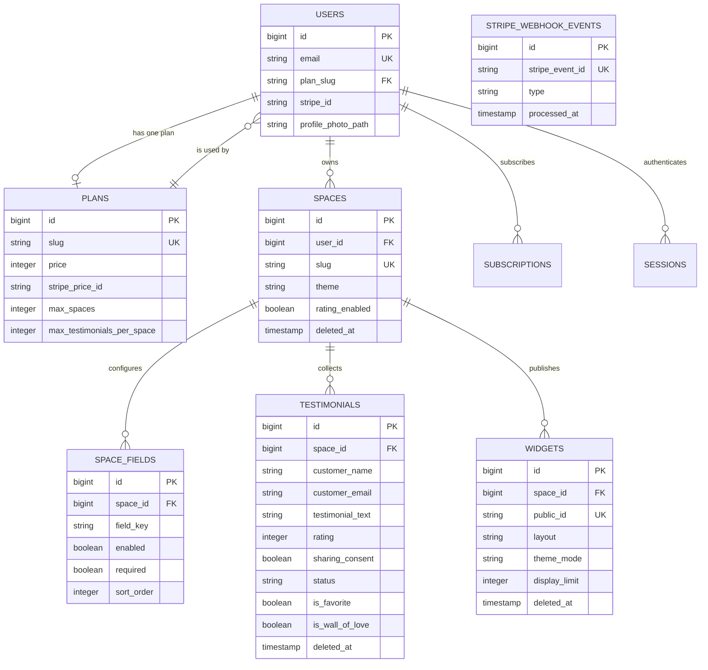

# Kudosly — data model

This document describes the database as it actually is in the code base. Every table,
column, relationship and constraint below was read from the migrations under
`database/migrations/` and the models under `app/Models/`, and the column list was
verified against a freshly migrated SQLite database.

The authoritative specification is section 13 of [`../PRD.md`](../PRD.md). The schema
matches that specification column for column, with the additions the implementation
required, which are called out below.

---

## Table of contents

- [Entity-relationship diagram](#entity-relationship-diagram)
- [Entity summary](#entity-summary)
- [Entities in detail](#entities-in-detail)
  - [users](#users)
  - [plans](#plans)
  - [spaces](#spaces)
  - [space_fields](#space_fields)
  - [testimonials](#testimonials)
  - [widgets](#widgets)
  - [stripe_webhook_events](#stripe_webhook_events)
- [Billing tables](#billing-tables)
- [Framework tables](#framework-tables)
- [Relationships in Eloquent](#relationships-in-eloquent)
- [Supporting enums](#supporting-enums)
- [Design notes](#design-notes)

---

## Entity-relationship diagram

**Not shown** are the framework tables (`sessions`, `cache`, `cache_locks`, `jobs`,
`job_batches`, `failed_jobs`, `password_reset_tokens`, `migrations`) and the two
Cashier billing tables (`subscriptions`, `subscription_items`), which have no
application-level foreign key to the entities above.

---

## Entity summary

| Table | Rows owned by | Purpose |
| --- | --- | --- |
| `users` | — | The account that owns spaces and pays for the plan |
| `plans` | — | The Free and Pro plan definitions and their limits |
| `spaces` | `users` | A branded collection page with a public URL |
| `space_fields` | `spaces` | Which fields the collection form shows |
| `testimonials` | `spaces` | One submitted testimonial |
| `widgets` | `spaces` | One embeddable display of a space |
| `stripe_webhook_events` | — | Processed Stripe event ids, for idempotency |

---

## Entities in detail

### users

The account that owns everything else. Created by
`0001_01_01_000000_create_users_table.php`, extended by
`2026_11_18_000001_add_plan_fields_to_users_table.php`,
`2026_11_18_000003_add_plan_foreign_key_to_users_table.php` and
`2026_11_22_120000_add_profile_photo_path_to_users_table.php`.

| Column | Type | Notes |
| --- | --- | --- |
| `id` | bigint | Primary key |
| `name` | string | Display name |
| `email` | string | Unique. Normalised to lower case on write by the `email` mutator in `App\Models\User` |
| `email_verified_at` | timestamp | Nullable |
| `password` | string | Hashed by the `hashed` cast |
| `remember_token` | string | Nullable, Laravel "remember me" |
| `plan_slug` | string | **Foreign key → `plans.slug`.** Added by the plan migration |
| `stripe_id` | string | Nullable. Cashier customer id |
| `billing_email` | string | Nullable. Where Stripe sends the invoice |
| `pm_type` | string | Nullable. Default payment method type |
| `pm_last_four` | string | Nullable. Last four digits only — no card data is ever stored |
| `trial_ends_at` | timestamp | Nullable |
| `profile_photo_path` | string | Nullable. Path on the `public` disk |
| `created_at`, `updated_at` | timestamps | |

**Model:** `App\Models\User` — casts `email_verified_at` to `datetime` and `password`
to `hashed`.

### plans

The plan definitions. Created by `2026_11_18_000002_create_plans_table.php`.

| Column | Type | Notes |
| --- | --- | --- |
| `id` | bigint | Primary key |
| `name` | string | `Free` or `Pro` |
| `slug` | string | Unique. Referenced by `users.plan_slug` |
| `price` | integer | **In cents.** `0` for Free, `99900` for Pro ($999/year) |
| `stripe_price_id` | string | Nullable. The Stripe price to charge |
| `max_spaces` | integer | `3` for Free, `25` for Pro |
| `max_testimonials_per_space` | integer | `100` for Free, `1000` for Pro |
| `created_at`, `updated_at` | timestamps | |

**Seed values** (`database/seeders/PlanSeeder.php`):

| name | slug | price | max_spaces | max_testimonials_per_space |
| --- | --- | --- | --- | --- |
| Free | `free` | 0 | 3 | 100 |
| Pro | `pro` | 99900 | 25 | 1000 |

**Model:** `App\Models\Plan`, with `type()` returning a `PlanType` enum and helpers
for the yearly price label.

### spaces

A branded collection page. Created by `2026_11_18_000004_create_spaces_table.php`,
extended by `2026_11_18_000005_create_space_fields_table.php` and
`2026_11_18_000008_add_soft_deletes_to_spaces_and_testimonials_table.php`.

| Column | Type | Notes |
| --- | --- | --- |
| `id` | bigint | Primary key |
| `user_id` | bigint | **Foreign key → `users.id`** |
| `name` | string | Internal name, e.g. "Onboarding" |
| `slug` | string | Unique. The public URL is `/s/{slug}` and `/wall/{slug}` |
| `title` | string | Heading shown on the public page |
| `subtitle` | string | Supporting line on the public page |
| `ask` | string | The question put to the customer |
| `theme` | string | A `SpaceTheme` value: `minimal-light`, `modern-dark`, `soft-gradient` |
| `rating_enabled` | boolean | Whether the form asks for a star rating |
| `created_at`, `updated_at` | timestamps | |
| `deleted_at` | timestamp | Nullable. Soft delete |

**Model:** `App\Models\Space`. Convenience methods include `testimonialCount()`,
`testimonialLimit()` (which reads the **owning account's** plan), and
`hasReachedTestimonialLimit()`.

### space_fields

Which optional fields a space's collection form shows. Created by
`2026_11_18_000005_create_space_fields_table.php`.

| Column | Type | Notes |
| --- | --- | --- |
| `id` | bigint | Primary key |
| `space_id` | bigint | **Foreign key → `spaces.id`** |
| `field_key` | string | A `SpaceFieldKey` value: `company_name`, `social_url`, `profile_photo` |
| `enabled` | boolean | Whether the field is shown at all |
| `required` | boolean | Whether the visitor must fill it in |
| `sort_order` | integer | Position in the form |
| `created_at`, `updated_at` | timestamps | |

**Model:** `App\Models\SpaceField`.

### testimonials

One submitted testimonial. Created by
`2026_11_18_000006_create_testimonials_table.php`, extended by
`2026_11_20_155202_create_customer_columns.php` and the soft-delete migration.

| Column | Type | Notes |
| --- | --- | --- |
| `id` | bigint | Primary key |
| `space_id` | bigint | **Foreign key → `spaces.id`** |
| `customer_name` | string | The visitor's name |
| `customer_email` | string | The visitor's e-mail. **Never exposed publicly** |
| `company_name` | string | Nullable |
| `social_url` | string | Nullable |
| `profile_photo_path` | string | Nullable. Path on the `public` disk |
| `testimonial_text` | string | The testimonial itself |
| `rating` | integer | Nullable. Only set when `spaces.rating_enabled` |
| `sharing_consent` | boolean | Whether the visitor agreed to appear publicly |
| `status` | string | A `TestimonialStatus` value: `pending`, `approved`, `hidden` |
| `is_favorite` | boolean | Pinned to the top of the inbox |
| `is_wall_of_love` | boolean | Included on the public wall |
| `created_at`, `updated_at` | timestamps | |
| `deleted_at` | timestamp | Nullable. Soft delete |

**Model:** `App\Models\Testimonial`. The `publiclyVisible` scope is the single place
that decides what may leave the application: it requires an approved status, a
sharing consent, and no soft delete.

### widgets

An embeddable display of a space. Created by
`2026_11_18_000007_create_widgets_table.php` and extended by the soft-delete
migration.

| Column | Type | Notes |
| --- | --- | --- |
| `id` | bigint | Primary key |
| `space_id` | bigint | **Foreign key → `spaces.id`** |
| `public_id` | string | Unique. Used in the public URL `/embed/{public_id}` |
| `layout` | string | A `WidgetLayout` value: `masonry`, `carousel` |
| `theme_mode` | string | A `WidgetThemeMode` value |
| `background_color` | string | Nullable |
| `animation_enabled` | boolean | Whether the carousel animates |
| `display_limit` | integer | Maximum testimonials to render |
| `created_at`, `updated_at` | timestamps | |
| `deleted_at` | timestamp | Nullable. Soft delete |

**Model:** `App\Models\Widget`. The `public_id` is generated automatically and the
model exposes `embedUrl()`, `embedScriptUrl()` and `embedDataUrl()`.

### stripe_webhook_events

Created by `2026_11_21_090000_create_stripe_webhook_events_table.php`.

| Column | Type | Notes |
| --- | --- | --- |
| `id` | bigint | Primary key |
| `stripe_event_id` | string | Unique. The Stripe event id, used to reject a replay |
| `type` | string | The Stripe event type |
| `processed_at` | timestamp | When it was handled |
| `created_at`, `updated_at` | timestamps | |

**Model:** `App\Models\StripeWebhookEvent`. This table is what makes webhook handling
idempotent: a duplicate event id is recognised and skipped instead of being applied
twice.

---

## Billing tables

Created by Laravel Cashier. They are managed by the framework and are not edited by
hand.

| Table | Purpose |
| --- | --- |
| `subscriptions` | The Stripe subscription state per user: `stripe_id`, `stripe_status`, `stripe_price`, trial and period columns |
| `subscription_items` | The individual line items of a subscription, including the metered `meter_id` and `meter_event_name` columns |

`2026_11_20_155205_add_meter_id_to_subscription_items_table.php` and
`2026_11_20_155206_add_meter_event_name_to_subscription_items_table.php` add the
metered-billing columns used to report usage to Stripe.

---

## Framework tables

| Table | Purpose |
| --- | --- |
| `migrations` | Which migrations have run |
| `sessions` | Web sessions (file driver by default) |
| `cache`, `cache_locks` | Application cache and its locks |
| `jobs`, `job_batches`, `failed_jobs` | Queued work, e-mail delivery among it |
| `password_reset_tokens` | Hashed password-reset tokens; a row is deleted the moment the password is changed |

---

## Relationships in Eloquent

Every foreign key above has a matching relationship method on the model.

| From | Method | To | Type |
| --- | --- | --- | --- |
| `User` | `plan()` | `Plan` | `BelongsTo`, joined on `plan_slug` → `plans.slug` |
| `User` | `spaces()` | `Space` | `HasMany` |
| `Plan` | — | `User` | Reached through `User::plan()` |
| `Space` | `user()` | `User` | `BelongsTo` |
| `Space` | `fields()` | `SpaceField` | `HasMany` |
| `Space` | `testimonials()` | `Testimonial` | `HasMany` |
| `Space` | `widgets()` | `Widget` | `HasMany` |
| `SpaceField` | `space()` | `Space` | `BelongsTo` |
| `Testimonial` | `space()` | `Space` | `BelongsTo` |
| `Widget` | `space()` | `Space` | `BelongsTo` |

`User` additionally exposes `currentPlan()`, `effectivePlan()`, `hasPlan()`,
`maxSpaces()`, `maxTestimonialsPerSpace()`, `canCreateSpace()` and
`spaceQuotaRemaining()`, which all resolve through
`App\Billing\PlanCatalog`. Those methods are what enforce the plan limits
server side.

### Scopes on `Testimonial`

| Scope | Meaning |
| --- | --- |
| `approved()` | Approved testimonials only |
| `publiclyVisible()` | Approved **and** consented **and** not deleted — the public filter |
| `favorited()` | Pinned to the top of the inbox |
| `wallOfLove()` | Included on the public wall |
| `orderedForInbox()` | The inbox ordering |

---

## Supporting enums

Defined under `app/Enums/` and stored as their string values.

| Enum | Cases |
| --- | --- |
| `PlanType` | `free`, `pro` |
| `TestimonialStatus` | `pending`, `approved`, `hidden` |
| `SpaceTheme` | `minimal-light`, `modern-dark`, `soft-gradient` |
| `SpaceFieldKey` | `company_name`, `social_url`, `profile_photo` |
| `WidgetLayout` | `masonry`, `carousel` |
| `WidgetThemeMode` | `light`, `dark` |

---

## Design notes

**The plan limits live in the database, not in code.** `plans.max_spaces` and
`plans.max_testimonials_per_space` are read through `PlanCatalog`, so changing a
limit is a data change rather than a code change, and the same number is used by the
UI counters and by the server-side checks.

**The plan is resolved from the stored slug, not from Stripe on every request.** The
Stripe webhook writes `users.plan_slug` when a subscription starts and when it
ends. Reading the plan therefore costs no API call and no latency.

**Soft deletes on `spaces`, `testimonials` and `widgets`.** A deleted testimonial is
hidden from the inbox, the wall and every widget, but the row is kept so the
deletion can be undone and so that a submission id cannot be reused by accident.

**`widgets.public_id` is separate from the primary key.** The public embed URL
carries a long random id rather than a sequential one, so the number of widgets in
an account cannot be guessed from a link.

**`space_fields` normalises the form configuration.** Instead of a nullable column
per optional field, one row per field holds `enabled`, `required` and `sort_order`.
Adding a new optional field is a new enum case and a new row, not a migration.

**`stripe_webhook_events` exists so a replay cannot double-apply.** The handler
records the event id before it acts on the event, and an id that is already present
is ignored.

---

## Related documentation

| Document | Contents |
| --- | --- |
| [`../PRD.md`](../PRD.md) | The specification, section 13 describes this schema |
| [`../CLAUDE.md`](../CLAUDE.md) | Development conventions, including the migration and seeder rules |
| [`deployment.md`](deployment.md) | Production deployment and operations runbook |
