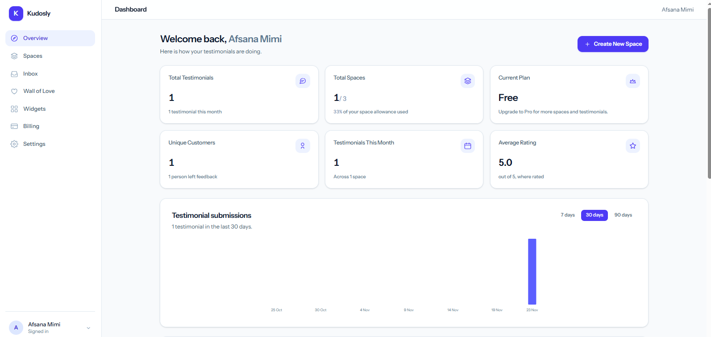
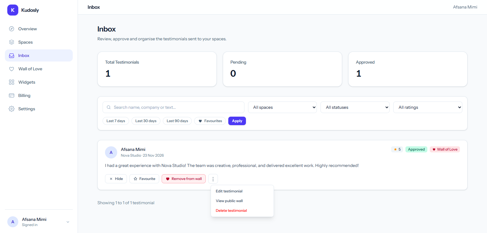
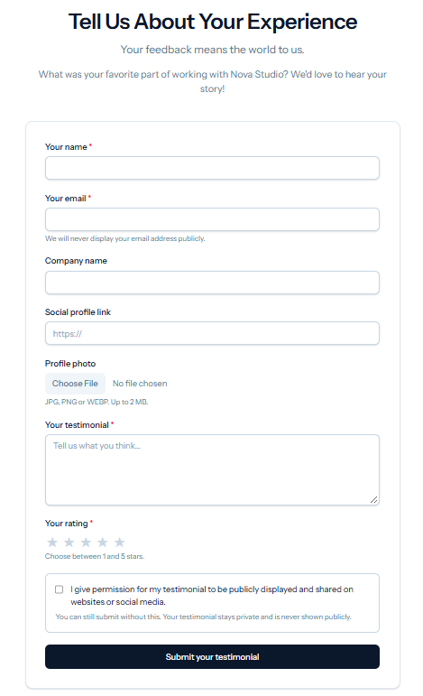
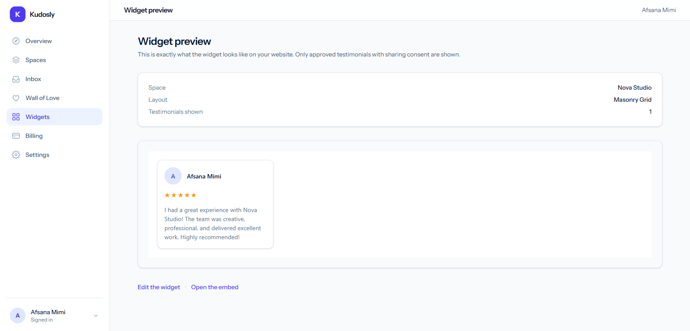
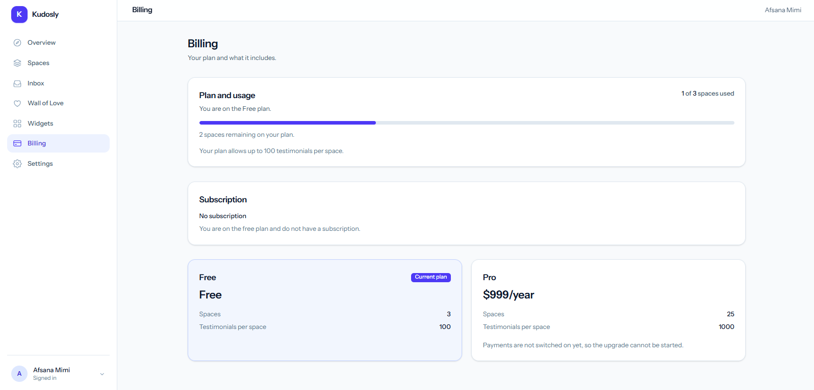

# Screenshots

Every image in this folder is a **genuine browser capture** of the current
Kudosly interface, taken by hand from the running application. Nothing here is a
mockup, a generated rendering, or a picture of a superseded layout.

---

## Included

| File | Screen | Contents |
| --- | --- | --- |
| `Dashboard_1.png` | Dashboard | The statistics cards, the "Testimonial submissions" chart and the space list |
| `Dashboard_2.png` | Dashboard (scrolled) | The spaces panel, the plan and usage bar and the recent testimonials |
| `Spaces_1.png` | Spaces | The spaces list with the counters, the public link and the per-space actions |
| `Spaces_2.png` | Public collection form | The collection form as an anonymous visitor sees it, with the rating, the optional fields and the consent checkbox |
| `Create Space.png` | Space builder | The create-space form with the rating toggle, the three themes and the live preview |
| `Inbox.png` | Inbox | The moderation inbox with the filters and the counters, and the three-dot actions menu **open** |
| `Wall of Love_1.png` | Wall of Love | The dashboard-side wall of love, showing the pinned testimonials |
| `Wall of Love_2.png` | Public wall of love | The public page at `/wall/{slug}`, showing only the approved and consented testimonials |
| `Widgets_1.png` | Widgets | The widgets list, showing the masonry layout, the light theme and the display limit |
| `Widgets_2.png` | Widget preview | The **rendered** widget, with the space, the layout and the testimonials it shows |
| `Create Widget.png` | Widget builder | The widget form — masonry or carousel, colour mode, background presets and hex, the display limit and the animation toggle |
| `Customer Testimonials.png` | Widget card | A single testimonial card as it appears inside the widget |
| `Billing.png` | Billing | The plan and usage bar, the subscription state and the Free and Pro comparison |
| `Profile.png` | Profile | The profile photo, profile information and password form |
| `Settings.png` | Settings | The settings page, showing the profile and password forms in context |

### The dashboard

### The inbox, with the actions menu open

The menu was the subject of a recent fix — it used to be clipped by the list
container. The capture shows it opening correctly, with edit, view public wall and
delete all visible.

### The public collection form

### The public wall of love

### The rendered widget

### Billing

---

## A note on the data in these captures

These were taken from a working account rather than from a seeded preview, so the
following is visible:

- the account holder's **display name**, in the page header and in the sidebar
- one **testimonial**, shown by its author's name, company and star rating
- one **space**, named *Nova Studio*, with its public slug

None of the following appear in any of the images:

- **No e-mail address.** The public wall, the widget preview and the collection
  form show no address at all — which is the application's own privacy
  behaviour, since a testimonial's e-mail is never exposed publicly. The profile
  and settings forms are shown empty.
- **No password, payment detail, API key or Stripe identifier.** The billing page
  shows the Free plan, with no card data and no customer portal session.
- **No uploaded profile picture.** The profile page states that no photo is set.

The captures are desktop-width only. There is no mobile set.

---

## Rules for captures

- **Never fabricate or generate an image.** Every file must be a real capture of
  the running application.
- **Never capture credentials or payment details.** Nothing that can be used to
  log in, charge a card or call an API belongs in a submitted screenshot.
- **Never capture a customer e-mail address.** The application already keeps it
  off every public page; a screenshot should not put it back.
- Only captures of the **current** interface belong in this folder. A
  superseded layout is not evidence.
